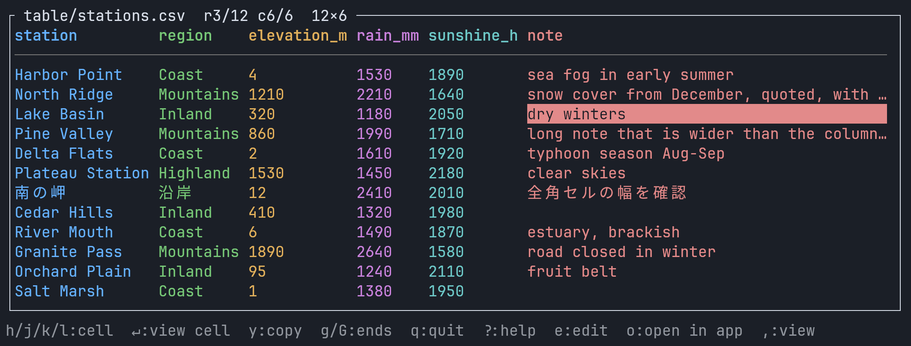
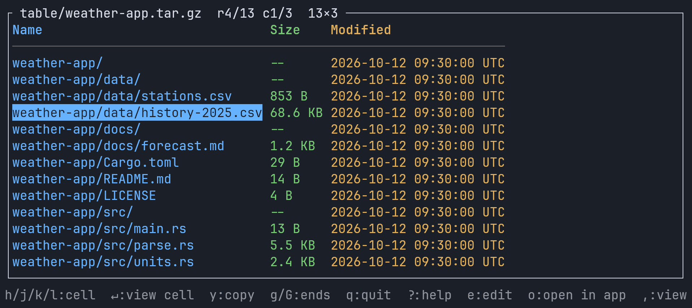

# konoma-table

The table plugins of [konoma](https://github.com/LESIM-Co-Ltd/konoma), a terminal file browser:
CSV/TSV files and zip/tar listings shown as a grid. They are built into konoma, and this repository
also builds a standalone program for one file.





| Crate | Contents |
|---|---|
| [`konoma-table`](crates/konoma-table/README.md) | The `csv` and `archive` plugins, the reading code and the `konoma-table` program |

Usage, keys, configuration and limits are in the
[crate README](crates/konoma-table/README.md).

## Try it

From a clone of this repository:

```sh
cargo run -- samples/sample.csv
cargo run -- samples/sample.zip
cargo run -- samples/sample.tar.gz
```

Press `q` to quit, `?` for the keys.

## Build and test

Rust 1.92 or newer.

```sh
cargo build
cargo test
cargo test --no-default-features
```

## License

MIT, as for [konoma](https://github.com/LESIM-Co-Ltd/konoma).
