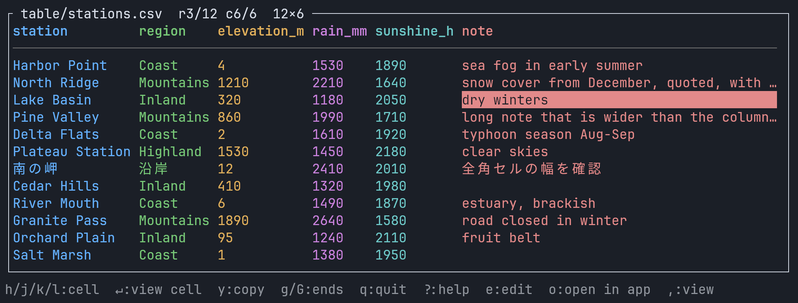
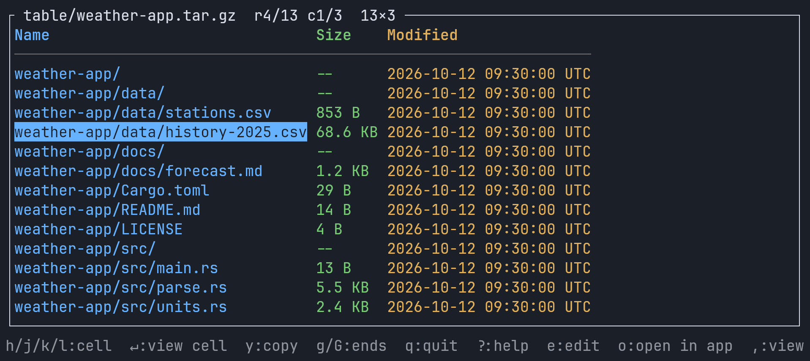

# konoma-table

CSV/TSV files and zip/tar listings shown as a grid in the terminal. It is part of
[konoma](https://github.com/LESIM-Co-Ltd/konoma), a terminal file browser, and also builds as a
program that shows one file.





| Plugin id | Files | What you see |
|---|---|---|
| `csv` | `*.csv`, `*.tsv` | The first record as the header, then the rows, with one color per column |
| `archive` | `*.zip`, `*.tar`, `*.tgz`, `*.tar.gz` | One row per entry: Name, Size, Modified |

```text
┌ samples/sample.zip  r1/4 c1/3  4×3 ──────────────────────────────────────────┐
│Name          Size  Modified                                                  │
│───────────────────────────────────────                                       │
│code/hello.rs 798 B 2026-06-23 17:00:22                                       │
│code/app.ts   668 B 2026-06-23 17:00:36                                       │
│code/calc.c   453 B 2026-06-23 17:00:54                                       │
│code/main.go  488 B 2026-06-23 17:00:50                                       │
└──────────────────────────────────────────────────────────────────────────────┘
h/j/k/l:cell  ↵:view cell  y:copy  g/G:ends  q:quit  ?:help  e:edit  o:open in app  ,:view
```

## With konoma

Both plugins are part of konoma's standard build, so there is nothing to add: konoma already shows
these files. Because of that, `konoma plugin install konoma-table` answers that there is nothing to
install. In konoma's `config.toml`, `[plugins.csv] enabled = false` or
`[plugins.archive] enabled = false` turns one off.

## Standalone program

```sh
cargo install konoma-table
konoma-table data.csv
```

It needs an interactive terminal on standard input and output. The grid is text: no graphics
protocol is needed. CI covers macOS and Linux.

### Command line

| Command | Effect |
|---|---|
| `konoma-table <file>` | Show one file |
| `konoma-table --help`, `-h` | Print the usage |
| `konoma-table --version` | Print the id and version of both plugins |
| `konoma-table --plugin <id> --version` | The same for `csv` or `archive` only |
| `konoma-table --plugin <id> --manifest` | Print what the plugin declares, as JSON |
| `konoma-table --plugin <id> --serve` | Speak konoma's plugin protocol on standard input and output (for a host, not for typing) |

`--manifest` and `--serve` require `--plugin` because the program carries two plugins.

Exit status 2 is a usage error or a file it does not take (missing, not a file, unreadable,
unsupported name). Status 1 is a failure to show it, such as a broken archive or no terminal.

### Keys

| Key | Action |
|---|---|
| `h` `j` `k` `l`, arrows | Move between cells |
| `g` / `G`, `Home` / `End` | Top / bottom |
| `0` / `$` | First / last column |
| `Ctrl-d` / `Ctrl-u` | Half a page |
| `Ctrl-f` / `Ctrl-b`, `PageDown` / `PageUp` | A page |
| `Enter` | Show the whole cell, wrapped; `Enter`, `Esc` or `q` closes it |
| `y` then `c` / `r` / `C` / `f` | Copy the cell / row / column / full file path |
| `e` | Open the file in your editor |
| `o` | Open the file in the OS default application (`open` on macOS, `xdg-open` elsewhere) |
| `,` then `p` | Change how the path in the title is written |
| `Space` | Menu of actions |
| `?` | Help |
| `q`, `Esc`, `Q`, `Ctrl-C` | Quit |

A copied row is joined with a comma for CSV and a tab for TSV. The program has no search, sorting
or filtering.

### Configuration

The program reads konoma's `config.toml` (`$XDG_CONFIG_HOME/konoma/config.toml`, otherwise
`~/.config/konoma/config.toml`). The file is optional. Settings that matter here:

| Setting | Effect |
|---|---|
| `ui.lang` | `"en"`, or `"jp"` / `"ja"` for Japanese. Unset, empty, `"auto"` or `"system"`: the first non-empty one of `LC_ALL`, `LC_MESSAGES`, `LANG` decides (starting with `ja` means Japanese; anything else, or none, English) |
| `ui.keys` | Paging key style, `"vim"` (default) or `"less"` |
| `[keys]`, `[keys.<name>]` | Your key assignments, as in konoma |
| `[editor]` | Editor for `e`; without it `$VISUAL`, then `$EDITOR`, then `vim` |
| `external.open_links` | `false` disables `o` |

`[plugins.csv] rainbow = false` turns the column colors off in konoma. The 0.1.0 standalone program
does not apply it, and it also ignores `[plugins.<id>] enabled`.

## Limits

- CSV/TSV: at most 100,000 data rows are read; the title then says `(capped)`.
  There is no limit on the file size in bytes or on the number of columns.
- CSV/TSV: the delimiter is a tab for `.tsv` and a comma otherwise. Bytes that are not valid UTF-8
  are shown as the replacement character, so other encodings do not display correctly.
- Archives: only entry names, sizes and times are read. Nothing is extracted, and entries are listed
  in archive order. At most 100,000 entries are listed.
- `.tar.gz` / `.tgz`: listing also stops after about 64 MiB of decompressed data.
- zip times are shown as stored (no time zone); tar times are shown in UTC.
- Other archive formats (such as `.tar.bz2`, `.tar.xz`, `.7z`) are not handled.

## As a library

Use `default-features = false` to leave out the standalone program (the `app` feature, on by
default).

```toml
[dependencies]
konoma-table = { version = "0.1", default-features = false }
anyhow = "1"
```

```rust,no_run
use std::path::Path;

use konoma_table::archive::{self, ArchiveKind};
use konoma_table::table;

fn main() -> anyhow::Result<()> {
    let csv = table::parse(Path::new("data.csv"), b',')?;
    println!("{} rows x {} columns", csv.nrows(), csv.ncols);
    println!("{} = {}", csv.header(1), csv.cell(0, 1));

    let path = Path::new("bundle.zip");
    if let Some(kind) = ArchiveKind::from_path(path) {
        for row in &archive::list(path, kind)?.rows {
            println!("{}", row.join("  "));
        }
    }
    Ok(())
}
```

- `table::parse` / `table::parse_cancellable` return a `TableData` (`headers`, `rows`, `ncols`,
  `truncated`).
- `archive::list` / `archive::list_cancellable` return the listing as a `TableData` too.
- `CsvPlugin`, `ArchivePlugin` and `plugins()` are the
  [konoma-plugin](https://crates.io/crates/konoma-plugin) implementations.
- The `test-hooks` feature exists for tests.

MSRV: Rust 1.92. License: MIT.
Repository: <https://github.com/LESIM-Co-Ltd/konoma-table>
